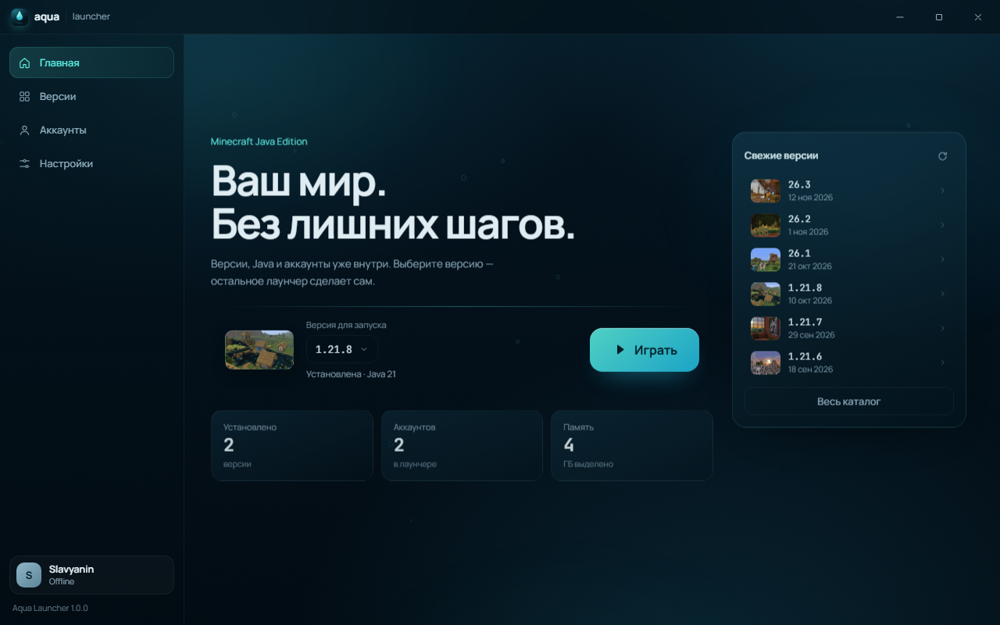
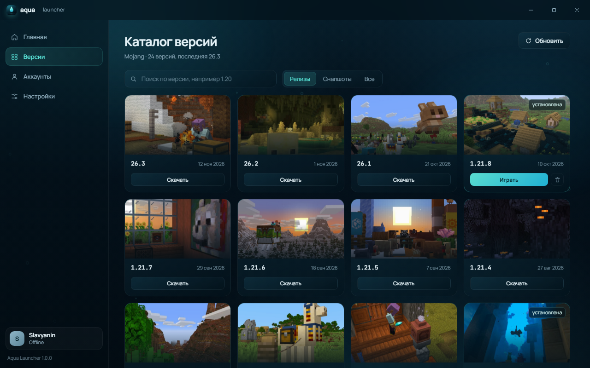
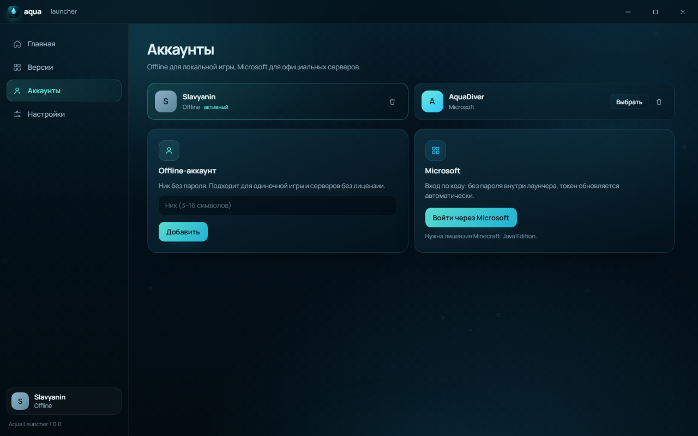
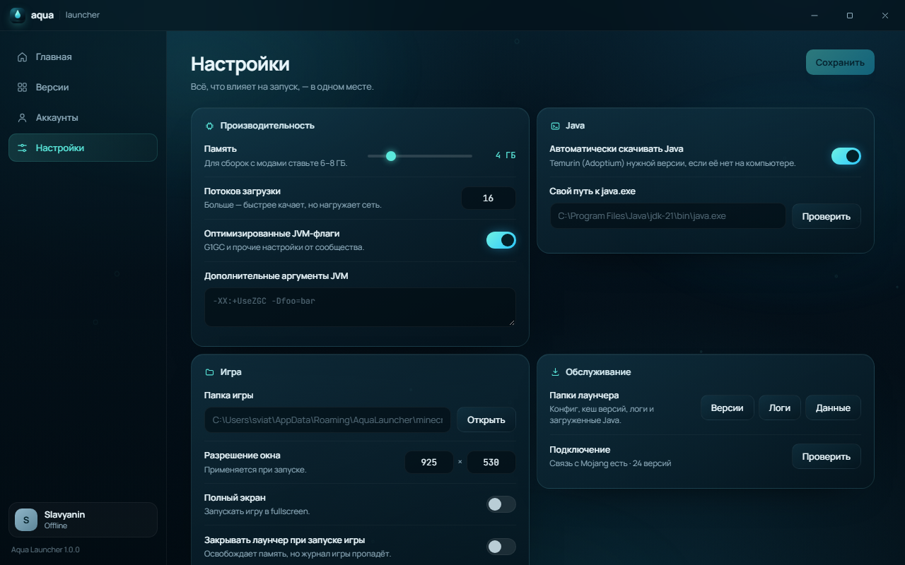

<p align="center">
  
</p>

<h1 align="center">Aqua Launcher</h1>

<p align="center">
  Лёгкий лаунчер Minecraft: Java Edition для Windows.<br />
  Rust + Tauri 2, интерфейс в стиле глубокого океана.
</p>

<p align="center">
  
  
  
  
</p>



## Возможности

- **Играть в один клик.** Лаунчер сам выбирает версию, Java и папку с игрой.
- **Офлайн-аккаунты.** Ник от 3 до 16 символов, стабильный offline-UUID, переключение между профилями.
- **Вход через Microsoft.** Device-code flow в отдельном окне: код, ссылка, ожидание — без ввода пароля в лаунчере.
- **Загрузка версий с серверов Mojang.** Манифест, клиент, библиотеки, нативы, ассеты — всё с проверкой SHA-1 и докачкой.
- **Своя Java.** Находит установленные рантаймы, при необходимости скачивает Temurin JRE нужной версии с Adoptium.
- **Настройки под себя.** Память, JVM-аргументы, Aikar-флаги, разрешение, папка с игрой, число потоков загрузки.
- **Живой прогресс и логи.** Этапы установки, скорость загрузки, консоль игры прямо в лаунчере.
- **Настоящие баннеры версий.** Обложки подтягиваются из официального `launchercontent.mojang.com`, для старых версий — аккуратная заглушка.

## Экраны

| Версии | Аккаунты | Настройки |
| --- | --- | --- |
|  |  |  |

## Требования

- Windows 10 или 11 (x64)
- WebView2 Runtime — есть в Windows 11 и в обновлённой Windows 10
- Rust 1.82+ и Cargo — только для сборки из исходников

## Сборка

```powershell
git clone https://github.com/227375488489/aqua-launcher.git
cd aqua-launcher/src-tauri
cargo build --release
```

Готовый файл: `src-tauri/target/release/aqua-launcher.exe`.

Интерфейс — статические файлы в `ui/` (без npm и бандлера), Rust-часть собирается сам по себе. Для инсталлятора нужен Tauri CLI:

```powershell
cargo install tauri-cli --version "^2"
cd src-tauri
cargo tauri build
```

## Структура

```
ui/                 интерфейс: index.html, styles.css, app.js
src-tauri/src/
  auth.rs           Microsoft device-code вход, XBL/XSTS, offline-UUID
  commands.rs       команды для фронтенда
  mc/install.rs     установка версии: клиент, библиотеки, ассеты
  mc/launch.rs      сборка аргументов JVM и игры
  mc/java.rs        поиск и загрузка Java
  mc/content.rs     баннеры версий из launchercontent.mojang.com
  mc/manifest.rs    список версий Mojang с кэшем
tools/              генератор иконок и загрузчик шрифтов
docs/screenshots/   скриншоты для README
```

## Данные

| Что | Где |
| --- | --- |
| Настройки и аккаунты | `%APPDATA%\AquaLauncher\config.json` |
| Игры и версии по умолчанию | `%APPDATA%\AquaLauncher\minecraft` |
| Java, скачанная лаунчером | `<папка игры>\java` |

Токены Microsoft хранятся локально в `config.json`. Файл не покидает машину, но и не шифруется — не выкладывайте его.

## Про вход через Microsoft

По умолчанию используется публичный client id `00000000402b5328` — тот же, что у старых лаунчеров. Он работает, но не принадлежит этому проекту. Для стабильной работы и своего бренда в окне входа создайте приложение в Azure Portal (тип: публичный клиент, устройство-код включён) и укажите его id в настройках (`msClientId`).

Вход в Microsoft нужен только для лицензионных аккаунтов. Офлайн-режим не требует сети и не связан с Mojang.

## Лицензия

MIT — см. [LICENSE](LICENSE).

Minecraft — торговая марка Mojang Studios. Проект не связан с Mojang и Microsoft.
