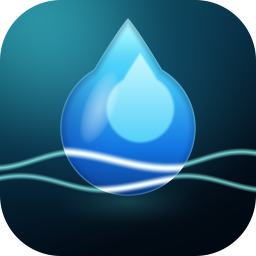

<p align="center">
  
</p>

<h1 align="center">Aqua Launcher 3.1</h1>

<p align="center">
  Лаунчер Minecraft: Java Edition для Windows, macOS и Linux.<br />
  Все версии, моды и сборки, изолированные профили и интерфейс, который можно собрать под себя.<br />
  Rust + Tauri 2, без Electron и без npm.
</p>

<p align="center">
  
  
  
  
  
  
  
</p>

<p align="center">
  <a href="https://github.com/227375488489/aqua-launcher/releases/latest"></a>
</p>

## Что нового в 3.1

- **Страницы проектов.** Клик по карточке мода или сборки открывает страницу как на CurseForge: скриншоты, описание, версии, лицензия и список модов внутри сборки.
- **Обновления с GitHub.** Лаунчер сам проверяет последний релиз и предлагает скачать новую версию; проверка также доступна в настройках.
- **Больше оформления.** 12 акцентов и любой свой цвет, фоновая аврора без пиксельных артефактов, новый логотип с волнами.
- **Фильтры версий.** Переключатели «Показывать снапшоты» и «Показывать старые версии» в настройках игры.
- **Свои картинки версий.** Для версий без официального баннера рисуется аккуратная обложка с номером.
- **Исправления.** Запуск игры снова работает, переключение языка больше не блокирует навигацию, карточки в каталоге не выходят за экран.

## Что нового в 3.0 «Aurora»

- **Сборки с Modrinth.** Каталог модпаков, установка `.mrpack` со всеми файлами, overrides и автоматическим Fabric-профилем. Каждая сборка живёт в своей папке — моды и конфиги не смешиваются.
- **Профили (инстансы).** Отдельный профиль на версию или сборку: свой набор модов, миров и настроек. Переключение одним кликом.
- **12 языков.** Русский, украинский, английский, казахский, польский, чешский, словацкий, французский, немецкий, итальянский, испанский, португальский. Определение языка системы и переключение на лету.
- **Кастомизация без границ.** Положение сайдбара и кнопки «Играть», режим иконок, порядок и видимость разделов, порядок виджетов на главной, 12 акцентов и свой цвет, темы, плотность, масштаб, обои с размытием и затемнением.
- **Статистика.** Время в игре по версиям, запуски, сессии, последний запуск — на главной и в профилях.
- **Новый дизайн и логотип.** Глубокий океан, стеклянные панели, мягкая аврора на фоне, аккуратная типографика Manrope, продуманные состояния и анимации 150–200 мс.
- **macOS и Linux.** Сборки `.dmg`, `.deb`, `.AppImage`, нативное окно на macOS, поиск Java в системных путях и распаковка `tar.gz`.
- **Быстрее.** Потоковая загрузка сразу на диск, параллельные соединения, кеш манифестов, проверка SHA-1, `opt-level 3` + LTO.

## Возможности

**Версии**
- Любая версия из официального манифеста Mojang: релизы, снапшоты, старые альфы и беты.
- Установка клиента, библиотек, нативов и ассетов с серверов Mojang, докачка и проверка хешей.
- Баннеры версий из `launchercontent.mojang.com`, для версий без баннера — своя обложка с номером.
- Поиск, фильтры (релизы, снапшоты, старые, установленные) и сортировка.
- Переключатели показа снапшотов и старых версий.

**Моды и сборки**
- Поиск модов, ресурспаков и шейдеров на Modrinth под выбранную версию.
- Установка с обязательными зависимостями, обход дерева зависимостей.
- Сборки `.mrpack`: файлы, overrides, иконка и отдельный профиль.
- Страница проекта: скриншоты, описание, версии и состав сборки.
- Проверка безопасности jar: исполняемые файлы внутри и опасные вызовы.
- Строгий режим, который блокирует подозрительные моды.
- Автопочинка: недостающие библиотеки и зависимости ставятся одной кнопкой.

**Аккаунты**
- Офлайн-аккаунт по нику: стабильный offline-UUID, 3–16 символов.
- Microsoft device-code: код и ссылка, без ввода пароля в лаунчере.
- Быстрое переключение аккаунтов и аватары.

**Производительность**
- Подбор памяти, дальности прорисовки и разрешения под ваш ПК.
- Оценка FPS с шейдерами по классу видеокарты.
- Aikar-флаги, свои JVM-аргументы, число потоков загрузки.
- Автопоиск Java и загрузка Temurin JRE нужной версии с Adoptium.

**Интерфейс**
- Тёмная, светлая и системная тема; 12 акцентов и свой цвет; три формы углов; три плотности.
- Масштаб интерфейса 80–140%, Manrope или системный шрифт, отключение анимаций.
- Обои: четыре пресета или своя картинка, размытие и затемнение.
- Редактор раскладки: порядок и видимость разделов и виджетов, позиция кнопки «Играть».
- Живой прогресс установки, консоль игры, тосты, модальные окна.

## Языки

`ru` `uk` `en` `kk` `pl` `cs` `sk` `fr` `de` `it` `es` `pt` — плюс режим «Авто» по языку системы.
Числа, даты и склонения используют `Intl`, поэтому формат соответствует выбранному языку.

Хотите добавить язык? Скопируйте `ui/lang/en.js`, переведите значения и подключите файл в `ui/locales.js`.

## Требования

| ОС | Требования |
| --- | --- |
| Windows 10/11 | WebView2 Runtime (есть в Windows 11 и обновлённой Windows 10) |
| macOS 10.15+ | Universal-сборка (Intel и Apple Silicon) |
| Linux | `webkit2gtk-4.1`, `libappindicator3`, `librsvg2`, `patchelf` |

Для сборки из исходников нужен Rust 1.82+ и Cargo.

## Сборка

```bash
git clone https://github.com/227375488489/aqua-launcher.git
cd aqua-launcher/src-tauri
cargo build --release
```

Бинарник: `src-tauri/target/release/aqua-launcher` (`.exe` на Windows).

Пакеты для текущей ОС:

```bash
cargo install tauri-cli --version "^2"
cd src-tauri
cargo tauri build
```

GitHub Actions собирает Windows, macOS и Linux на каждый тег `v*` и прикладывает установщики к релизу. Интерфейс — статические файлы в `ui/`, собирать его не нужно.

## Структура

```
ui/
  index.html          разметка всех экранов
  styles.css          дизайн-система и адаптив
  app.js              вся логика интерфейса
  i18n.js             движок переводов, Intl
  locales.js          подключение языков
  lang/*.js           12 словарей
  demo.js             демо-бэкенд для просмотра в браузере
src-tauri/src/
  state.rs            настройки, аккаунты, профили, статистика
  commands.rs         команды для фронтенда
  mc/install.rs       установка версии: клиент, библиотеки, ассеты
  mc/version.rs       манифест версии, наследование загрузчиков
  mc/fabric.rs        установка Fabric
  mc/modpack.rs       сборки Modrinth (.mrpack)
  mc/mods.rs          Modrinth: поиск, зависимости, проверка jar
  mc/launch.rs        аргументы JVM и игры
  mc/java.rs          поиск и загрузка Java (Windows/macOS/Linux)
  system.rs           опрос оборудования на трёх ОС
tools/                генератор иконок (PNG/ICO/ICNS) и шрифты
```

## Данные

| Что | Windows | macOS | Linux |
| --- | --- | --- | --- |
| Настройки и аккаунты | `%APPDATA%\AquaLauncher\config.json` | `~/Library/Application Support/AquaLauncher/config.json` | `~/.local/share/AquaLauncher/config.json` |
| Игры и версии | `%APPDATA%\AquaLauncher\minecraft` | `~/Library/Application Support/AquaLauncher/minecraft` | `~/.local/share/AquaLauncher/minecraft` |
| Профили сборок | `<папка игры>\profiles` | то же | то же |
| Java от лаунчера | `<папка игры>\java` | то же | то же |

Токены Microsoft хранятся локально в `config.json`. Файл не покидает машину, но и не шифруется — не выкладывайте его.

## Ограничения

- Загрузчики модов: автоматически ставится **Fabric**. Сборки на Forge, NeoForge и Quilt пока не поддерживаются — лаунчер сообщит об этом до скачивания.
- Моды ставятся в активный профиль. Для модов нужен Fabric-профиль: лаунчер предложит создать его сам.
- Вход Microsoft использует публичный client id `00000000402b5328`. Для стабильной работы создайте своё приложение в Azure Portal (публичный клиент, device-code) и укажите id в настройках (`msClientId`).

## Лицензия

MIT — см. [LICENSE](LICENSE).

Minecraft — торговая марка Mojang Studios. Проект не связан с Mojang и Microsoft.
